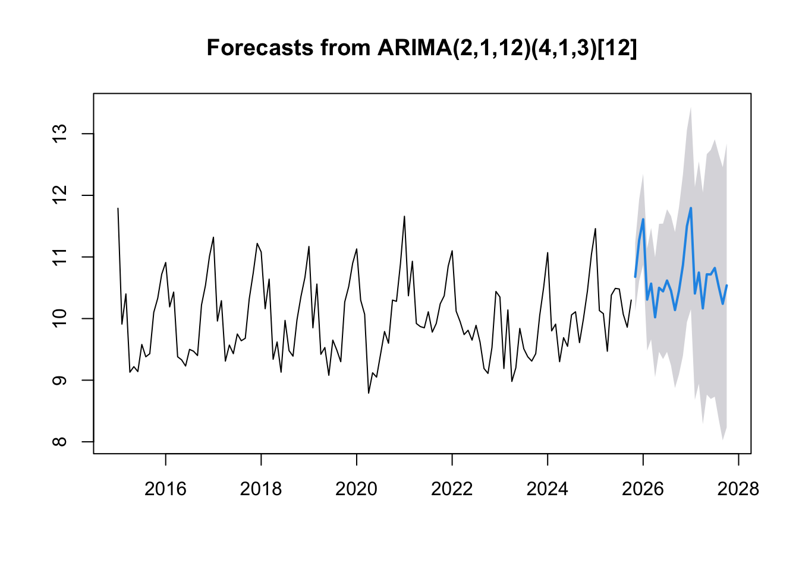

# Netherlands Electricity Demand: Unit Roots & SARIMA Forecast

Time series econometrics project (Master IREF, University of Bordeaux, 2026). Models and forecasts monthly electricity demand in the Netherlands, January 2015 – October 2025.



## Key results

- Demand shows strong seasonality (winter peaks) but no significant deterministic trend (around 10 TWh/month).
- On the seasonally differenced series, the Lee–Strazicich test finds a unit root with a structural break in **February 2022**, when the war in Ukraine sent energy prices up.
- Final model: **SARIMA(2,1,12)(4,1,3)[12]**, pruned to 11 significant parameters.
- Residuals pass the Ljung-Box and ARCH-LM tests but are not Gaussian (Jarque-Bera), so the 95% intervals are indicative only.
- Forecast horizon: 24 months, to October 2027.

## Method

1. **Exploration:** energy mix, net imports, day-ahead price, seasonality.
2. **Unit root tests:** Dickey-Fuller, ADF (Schwert + MAIC lag selection), Zivot–Andrews, Lee–Strazicich with one and two breaks.
3. **Identification:** EACF on the stationary series, then backward elimination of non-significant ARMA terms.
4. **Diagnostics:** Ljung-Box, ARCH-LM, Jarque-Bera.
5. **Forecast:** re-integration of the unit root and the seasonal component into a SARIMA model.

## Reports (in French)

- [Part 1: exploration and unit root tests](https://htmlpreview.github.io/?https://github.com/VianneyMathon/Netherlands-Electricity-Demand-SARIMA/blob/main/part1_unit_root_tests.html)
- [Part 2: modelling, diagnostics and forecast](https://htmlpreview.github.io/?https://github.com/VianneyMathon/Netherlands-Electricity-Demand-SARIMA/blob/main/part2_sarima_forecast.html)

## Repository

| Path | Content |
|---|---|
| `part1_unit_root_tests.Rmd` | Exploration and unit root tests |
| `part2_sarima_forecast.Rmd` | Model identification, diagnostics and forecast |
| `data/` | Ember monthly electricity data, Netherlands only |
| `R/LeeStrazicichUnitRoot/` | Third-party implementation of the Lee–Strazicich test (GPL-3.0, see its README) |

## Run

R ≥ 4.0 with `rmarkdown`, `ggplot2`, `urca`, `CADFtest`, `zoo`, `forecast`, `lmtest`, `TSA`, `FinTS`, `tseries`.

```r
rmarkdown::render("part1_unit_root_tests.Rmd")
rmarkdown::render("part2_sarima_forecast.Rmd")
```

## Data

[Ember – Monthly Electricity Data](https://ember-energy.org/data/monthly-electricity-data/) (CC BY 4.0).
